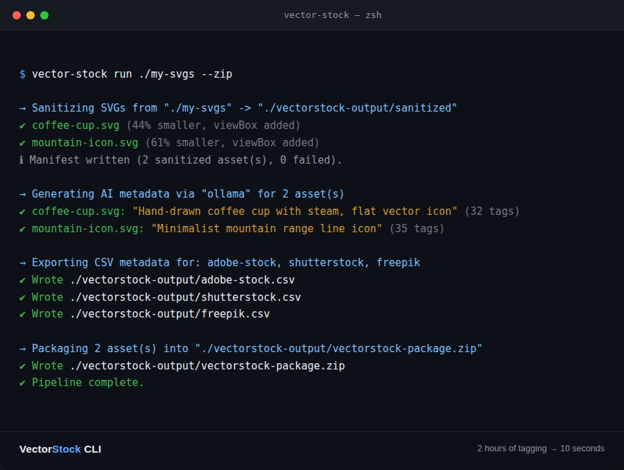

# 🎨 VectorStock CLI

**From 2 hours of manual tagging to 10 seconds — sanitize, AI-tag, and package your SVGs for Adobe Stock, Shutterstock, and Freepik in one command.**



## What it does

If you sell vector assets on microstock marketplaces, you know the real bottleneck isn't drawing — it's the metadata. Every SVG needs a clean `viewBox`, a commercial title, and 30-50 relevant tags, formatted differently for every marketplace you upload to. VectorStock CLI automates all of it:

- **Sanitizes** your SVGs with [SVGO](https://github.com/svg/svgo) tuned for stock submissions — nested `<g transform>` chains collapse to a single minimal transform (or disappear entirely), editor cruft is stripped, and a missing `viewBox` is safely derived from `width`/`height`.
- **Auto-generates titles and tags with AI** — local via [Ollama](https://ollama.com) at zero cost with no data leaving your machine, or OpenAI/Anthropic when you want a stronger model. It never blocks your batch: if the AI is unreachable, it degrades to deterministic, structure-derived metadata instead of failing.
- **Exports the exact CSV each marketplace expects** — Adobe Stock, Shutterstock, and Freepik each require different column layouts; this ships one exporter per marketplace instead of a generic keyword dump.
- **Packages everything into a ready-to-upload ZIP**, sidecar `.eps`/`.png` files included automatically.

```bash
npx vector-stock-cli run ./my-svgs --zip --marketplaces adobe-stock,shutterstock
```

## Built like production software, not a script

This isn't a weekend hack. The full source went through a genuine, documented audit — every finding backed by a failing test before the fix and a passing one after, verified end-to-end through the real compiled CLI (not just unit tests). Recent findings included a CSV formula-injection defuse (OWASP), a filename-collision fix for assets sharing a basename across subfolders, and a fix for a stale warning that never cleared after a successful AI retag. The full report ([AUDIT.md](https://github.com/Evangelikcaos/vector-stock-cli/blob/main/AUDIT.md)) ships right in the public repository, alongside the code.

- TypeScript, strict mode, zero `any` in the public surface.
- 45 automated tests covering the sanitizer, structural analyzer, AI fallback behavior, CSV exporters, and config validation — with real SVG/XML fixtures, not mocks.
- GitHub Actions CI on every push: typecheck, unit tests, build, and an end-to-end smoke test through the actual `bin/` entry point.
- MIT licensed.

## Get the source

VectorStock CLI is fully open source (MIT licensed) — there is no separate paid edition. Grab the real source, install it, and read the full audit report directly in the public repository:

**[github.com/Evangelikcaos/vector-stock-cli →](https://github.com/Evangelikcaos/vector-stock-cli)**

```bash
npm install -g vector-stock-cli
```

If it saves you time, a star on the repo is appreciated.

## Stack

Node.js 20+, TypeScript, SVGO, fast-xml-parser, archiver, commander, vitest.

---

*This is a showcase/landing page. The actual source code lives in the public repository linked above.*

## 🔗 Other projects

More tools from the same author:

- **[LocalVectorSync](https://github.com/Evangelikcaos/local-vector-sync)** — local-first, privacy-native vector search engine for Node/Tauri/Electron, with optional encrypted S3/R2 sync.
- **[ASTify](https://github.com/Evangelikcaos/AStify-app)** — AI-guided AST-based diff pruner that cuts LLM context tokens 70-80% in PR/CI code review.
- **[ArtemisMock](https://github.com/Evangelikcaos/ArtemisMock-app)** — fully local, AI-guided real-time mock API server generated from OpenAPI/Prisma schemas.
- **[ChronosGit](https://github.com/Evangelikcaos/ChronosGit-app)** — time-aware version control that blocks commits/pushes before expiring code reaches production.
